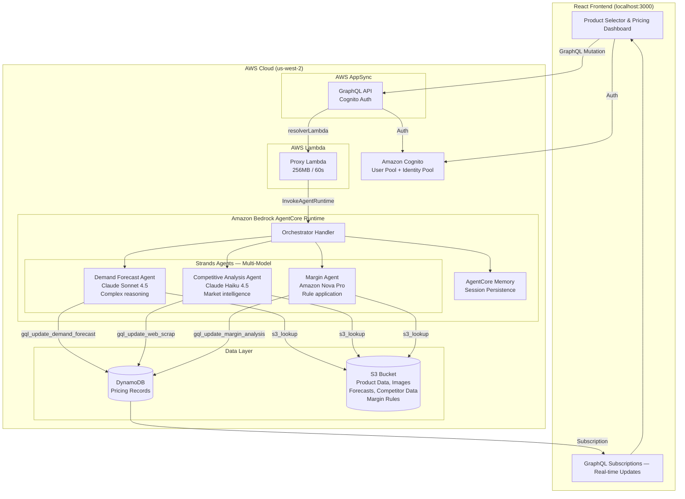
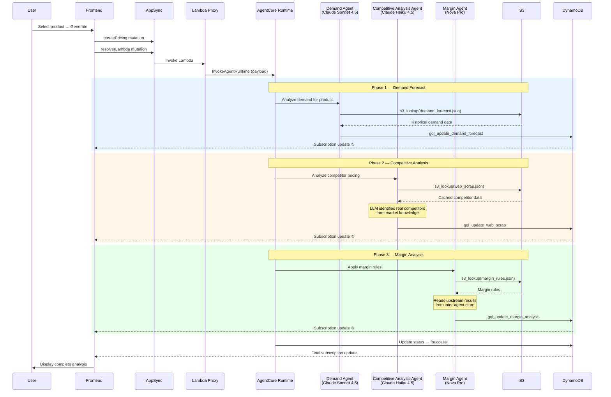
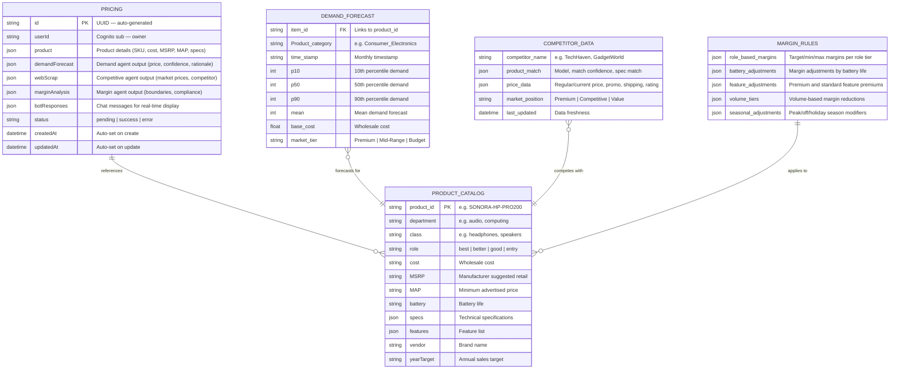

# Retail Pricing Agent — Powered by Amazon Bedrock AgentCore

An AI-driven multi-agent system that determines optimal retail product pricing and generates personalized customer offers by orchestrating specialized agents across multiple foundation models (Claude Sonnet 4.5, Claude Haiku 4.5, Amazon Nova Pro, OpenAI gpt-oss-120b) for demand forecasting, competitive analysis, margin compliance, and customer-specific discounting — deployed on Amazon Bedrock AgentCore with real-time frontend visualization.

This repository contains sample code intended for demonstration and educational purposes only. It is not suitable for production use.

---

## Problem Statement

Retail pricing decisions are complex, high-stakes, and slow. A single pricing decision for one SKU requires a merchandising analyst to:

- Pull historical demand data from forecasting systems and interpret confidence intervals
- Research 5–10 competitor prices across multiple websites, factoring in promotions, shipping, and stock levels
- Apply category-specific margin rules, MAP (Minimum Advertised Price) constraints, feature-based adjustments, and seasonal modifiers
- Reconcile conflicting signals — strong demand may suggest raising prices while competitive pressure says lower them
- Document the rationale for compliance and audit trails

This process takes **30–60 minutes per SKU**. A retailer with 10,000 SKUs reviewing prices quarterly faces **5,000–10,000 analyst-hours per cycle**. Decisions are inconsistent across analysts, slow to react to market changes, and impossible to scale.

On top of that, **personalized pricing is almost never done**. Even when a retailer knows a customer is a loyal Platinum member who always buys audio equipment with their brand credit card, the price they see is the same as everyone else. Building personalized offers requires:

- Querying customer profiles across loyalty, payment, and behavioral systems
- Calculating layered discounts (loyalty tier + payment method + shopping persona)
- Validating that the personalized price still meets minimum margin requirements
- Generating a unique offer message with expiration and exclusivity

This is too complex to do manually at scale. Most retailers default to broad promotions that leave money on the table — discounting for customers who would have paid full price, while not rewarding their most valuable customers enough.

## Business Value Proposition

This system reduces per-SKU pricing time from **30–60 minutes to under 3 minutes** — a 10–20x improvement — while delivering:

- **Consistency**: Every pricing decision follows the same margin rules, MAP compliance checks, and competitive benchmarking methodology
- **Speed**: React to competitor price changes within minutes instead of days
- **Transparency**: Every recommendation includes a full rationale with demand insights, competitive positioning, and margin calculations — auditable and explainable
- **Scale**: Price 10,000 SKUs in the time it previously took to price 100
- **Margin Protection**: Automated MAP compliance and minimum margin enforcement eliminates human error on pricing floors
- **Personalization at Scale**: Generate unique, margin-safe offers for every customer based on their loyalty tier, payment method, and shopping behavior — something impossible to do manually
- **Customer Lifetime Value**: Reward high-value customers (Platinum members, brand card holders, category enthusiasts) with exclusive discounts that drive retention and repeat purchases
- **Revenue Optimization**: Stop giving blanket discounts — personalized pricing ensures each customer gets the right discount (not too much, not too little) while protecting margins

---

## Architecture



## Agent Chain Flow



---

## Data Model



### Data Storage

| Data | Storage | Access Pattern |
|------|---------|---------------|
| Pricing records | DynamoDB (`PricingAgent-Pricing`) | By ID (get), by userId (GSI query), real-time subscriptions |
| Customer profiles | DynamoDB (`PricingAgent-CustomerProfiles`) | By customerId (get), by loyaltyTier (GSI query) |
| Purchase history | DynamoDB (`PricingAgent-PurchaseHistory`) | By customerId + orderId (query), most recent first |
| Product catalog | S3 (`products/products.json`) | Read by frontend (Amplify Storage) and agents (s3_lookup tool) |
| Demand forecasts | S3 (`data/demand_forecast.json`) | Read by Demand Forecast Agent via s3_lookup |
| Competitor data | S3 (`data/web_scrap.json`) | Cached competitor data read by Competitive Analysis Agent (supplemented by LLM market knowledge) |
| Margin rules | S3 (`data/margin_rules.json`) | Read by Margin Agent via s3_lookup |
| Personalization rules | S3 (`data/personalization_rules.json`) | Read by Personalization Agent via s3_lookup |
| Product images | S3 (`products/*.png`) | Read by frontend (Amplify Storage) |
| Competitor store listings | S3 (`builder-depot/listings.json`, `tool-master/listings.json`) | Read by frontend Competitor page |
| Competitor product images | S3 (`builder-depot/*.png`, `tool-master/*.png`) | Read by frontend Competitor product cards |

---

## Project Structure

```
.
├── scripts/                            # Deployment & teardown scripts (run from repo root)
│   ├── deploy.sh                       #   Full backend deployment
│   ├── deploy-frontend.sh              #   Build & deploy React app to S3 + CloudFront
│   ├── cleanup.sh                      #   Tear down all backend resources
│   └── cleanup-frontend.sh             #   Tear down CloudFront + S3 website
│
├── pricing-agent-agentcore/            # Backend — AgentCore Runtime + CDK infra
│   ├── handler.py                      #   AgentCore Runtime entrypoint (orchestrates 3-agent chain)
│   ├── agents.py                       #   Strands Agent factory functions (demand, web, margin, personalization) — each uses a different model
│   ├── prompts.py                      #   Agent system prompts with output schemas
│   ├── tools.py                        #   Strands @tool implementations (S3, GraphQL, store)
│   ├── store.py                        #   Request-scoped inter-agent data store
│   ├── gql_client.py                   #   GraphQL client for AppSync mutations
│   ├── memory_manager.py               #   AgentCore Memory + real-time bot response push
│   ├── prompts_personalization.py      #   Personalization Agent system prompt
│   ├── tools_personalization.py        #   Personalization tools (customer profile, history, pricing)
│   ├── config.py                       #   Centralized configuration
│   ├── requirements.txt                #   Python dependencies (runtime + CLI + seed tools)
│   ├── seed_data.py                    #   Generate all synthetic data + images
│   ├── seed_customers.py               #   Seed customer profiles + purchase history to DynamoDB
│   ├── generate_competitor_screenshots.py  # Standalone competitor screenshot generator
│   ├── test_local.py                   #   Local testing without deployment
│   ├── proxy_lambda/                   #   Thin Lambda proxy (AppSync → AgentCore Runtime)
│   │   ├── index.py
│   │   └── requirements.txt
│   └── infra/                          #   CDK infrastructure
│       ├── app.py
│       ├── cdk.json
│       ├── schema.graphql              #   Full AppSync schema (Amplify-compatible)
│       └── stacks/
│           └── pricing_stack.py        #   All AWS resources in one stack
│
├── pricing-agent-ui/                   # Frontend — React app
│   ├── src/
│   │   ├── pages/                      #   Home, Pricing, Competitor, Executions
│   │   ├── components/                 #   ProductSelector, MultiAgentFlow, StoreItems, etc.
│   │   ├── hooks/                      #   useApi, useStorage
│   │   ├── graphql/                    #   Generated mutations, queries, subscriptions
│   │   └── App.tsx                     #   Amplify configuration + routing
│   ├── package.json
│   └── vite.config.ts
│
└── README.md
```

---

## Scripts

All scripts are in the `scripts/` directory and run from the repo root.

### `scripts/deploy.sh` — Full Backend Deployment

Deploys everything from scratch in 7 steps:

1. Sets up Python virtual environments and installs dependencies
2. CDK bootstrap + deploy (S3, Cognito, AppSync, DynamoDB tables including CustomerProfiles and PurchaseHistory, Lambda proxy)
3. Generates seed data with Nova Lite (products, forecasts, competitors, margin rules) and Nova Canvas (product images, competitor images, competitor screenshots)
4. Uploads all seed data to S3, seeds customer profiles (13 customers) and purchase history to DynamoDB
5. Configures and deploys AgentCore Runtime via `agentcore deploy`, injects environment variables (DATA_BUCKET, table names, region), grants DynamoDB access to the runtime IAM role
6. Wires the proxy Lambda's environment variables (`AGENT_RUNTIME_ARN`, `GRAPH_API_URL`, `DATA_BUCKET`, `CUSTOMER_PROFILE_TABLE`, `PURCHASE_HISTORY_TABLE`)
7. Creates Cognito demo user (password from `DEMO_PASSWORD` env var), sets S3 CORS, writes frontend `.env.local`

```bash
# Full deploy (set DEMO_PASSWORD first)
export DEMO_PASSWORD='YourSecureP@ss1'
./scripts/deploy.sh --region us-west-2

# Deploy without images (faster, ~5 min instead of ~15 min)
./scripts/deploy.sh --region us-west-2 --skip-images

# Deploy with a specific account
./scripts/deploy.sh --region us-west-2 --account 123456789012

# Skip seed data entirely (reuse existing S3 data)
./scripts/deploy.sh --region us-west-2 --skip-seed
```

### `scripts/deploy-frontend.sh` — Frontend Deployment

Builds the React app and deploys to S3 + CloudFront:

1. Creates an S3 bucket for static website hosting
2. Creates a CloudFront distribution with OAC (HTTPS only, TLS 1.2, SPA routing)
3. Updates Cognito callback URLs to include the CloudFront domain
4. Builds the React app with production environment variables
5. Syncs build output to S3 and invalidates CloudFront cache

```bash
./scripts/deploy-frontend.sh --region us-west-2
```

### `scripts/cleanup.sh` — Full Backend Teardown

Destroys all backend resources in reverse order:

1. Deletes AgentCore Runtime + Memory
2. Cleans AgentCore S3 artifacts
3. Deletes Cognito demo user
4. Destroys CDK stack (S3, Cognito, AppSync, DynamoDB, Lambda)
5. Deletes frontend CloudFront + S3 (if deployed)
6. Removes local generated files

```bash
# Full cleanup
./scripts/cleanup.sh --region us-west-2

# Cleanup but keep local files (seed_output, deployment.json, etc.)
./scripts/cleanup.sh --region us-west-2 --keep-local
```

### `scripts/cleanup-frontend.sh` — Frontend Teardown

Tears down only the frontend deployment:

1. Disables and deletes the CloudFront distribution + OAC
2. Empties and deletes the S3 website bucket
3. Cleans local build artifacts (`dist/`, `.env.production`)

```bash
./scripts/cleanup-frontend.sh --region us-west-2
```

---

## Quick Start

### Prerequisites

- AWS CLI configured with credentials (`aws configure`)
- Node.js 20+ and CDK CLI (`npm install -g aws-cdk`)
- Python 3.12+
- Bedrock model access enabled for: Claude Sonnet 4.5, Claude Haiku 4.5, Amazon Nova Lite, Amazon Nova Pro, Amazon Nova Canvas, OpenAI gpt-oss-120b

### Deploy Backend

```bash
chmod +x scripts/*.sh

# Set your AWS account ID (required)
export CDK_DEFAULT_ACCOUNT=$(aws sts get-caller-identity --query Account --output text)
export CDK_DEFAULT_REGION=us-west-2

# Set the demo user password (required — not hardcoded for security)
export DEMO_PASSWORD='YourSecureP@ss1'

./scripts/deploy.sh --region us-west-2
```

This takes ~15 minutes and deploys everything: CDK infrastructure, seed data (products, forecasts, competitors, margin rules), product images, competitor product images, competitor site screenshots, store listings, customer profiles (13 customers across loyalty tiers and personas), purchase history, AgentCore Runtime with personalization agent, and creates a demo user.

### Run the Frontend Locally

```bash
cd pricing-agent-ui
npm install --ignore-scripts
npm run dev
# Open http://localhost:3000
# Login: demo@example.com / <password you set in DEMO_PASSWORD>
```

### Deploy Frontend to AWS

```bash
./scripts/deploy-frontend.sh --region us-west-2
# Deploys to CloudFront — URL printed at the end
```

### Teardown

```bash
# Remove frontend (CloudFront + S3)
./scripts/cleanup-frontend.sh --region us-west-2

# Remove everything (backend + all AWS resources)
./scripts/cleanup.sh --region us-west-2
```

---

## How It Works

1. User selects a product on the Home page and clicks "Generate"
2. Frontend creates a Pricing record in DynamoDB and calls the `resolverLambda` GraphQL mutation
3. The proxy Lambda forwards the request to AgentCore Runtime
4. The orchestrator handler runs agents sequentially, each using a different best-in-class model:

   **Phase 1 — Demand Forecast Agent** *(Claude Sonnet 4.5)* reads `demand_forecast.json` from S3, analyzes historical demand patterns, seasonality, and product attributes, then generates a recommended price with confidence intervals (p10/p50/p90). Writes results to DynamoDB via `gql_update_demand_forecast`.

   **Phase 2 — Competitive Analysis Agent** *(Claude Haiku 4.5)* uses the LLM's knowledge of real consumer electronics products and current market prices to identify competing products from major brands (Sony, Bose, Samsung, Apple, etc.), determines our product's relative market position, and recommends base and promotional prices. Also reads cached competitor data from S3 for additional context. Returns a ranked list of competitor products with prices for the Market Position display. Writes results via `gql_update_web_scrap`.

   **Phase 3 — Margin Agent** *(Amazon Nova Pro)* reads `margin_rules.json` from S3 plus the upstream results from Phase 1 and 2 (via the inter-agent store), applies role-based margins, feature adjustments, volume tiers, and seasonal modifiers, then produces final pricing boundaries with MAP compliance validation. Writes results via `gql_update_margin_analysis`.

   **Phase 4 — Personalization Agent** *(OpenAI gpt-oss-120b on Bedrock)* *(runs only when a customer is selected)* reads the customer profile and purchase history from DynamoDB, loads personalization rules from S3, then applies a layered discount: loyalty tier (5–15%) → payment method bonus (2–3%) → behavioral persona affinity (2–3%). Validates the final price against the margin promotional floor and writes results via `gql_update_personalized_pricing`.

5. Each GraphQL mutation triggers a DynamoDB update, which fires the `onPricingById` subscription
6. The frontend receives real-time updates and renders demand, competitive, margin, and personalized pricing panels as each agent completes

---

## Personalized Pricing

The system supports customer-specific pricing through a 4th agent phase that applies layered discounts based on the customer's profile.

### Customer Dimensions

| Dimension | Options | Discount Range |
|-----------|---------|---------------|
| Loyalty Tier | Platinum, Gold, Silver, Standard | 0–15% |
| Payment Method | Brand Credit Card, Store Gift Card, Standard | 0–3% |
| Behavioral Persona | Audiophile, Fitness Enthusiast, Movie Lover, Early Adopter, Budget Conscious | 0–3% (category match) |

### How It Works

1. User selects a product on the Home page — relevant personas are automatically filtered based on the product category (e.g., selecting headphones shows Audiophile, Gamer, Remote Worker, Traveler personas)
2. User picks a persona and loyalty tier — the system maps this to a seeded customer profile
3. The `customerID` is passed through the GraphQL mutation → proxy Lambda → AgentCore Runtime
4. After the Margin Agent completes (Phase 3), the Personalization Agent (Phase 4) runs:
   - Reads the customer profile from DynamoDB (`PricingAgent-CustomerProfiles`)
   - Reads purchase history from DynamoDB (`PricingAgent-PurchaseHistory`)
   - Loads personalization rules from S3 (`data/personalization_rules.json`)
   - Applies discounts in order: loyalty tier → payment bonus → persona affinity
   - Validates the final price against the margin promotional floor
   - If the discount would breach the floor, it caps the discount and flags it
4. Results are written to DynamoDB and displayed in the "Personalized Price" tab

### Seeded Customer Profiles

| Customer | Tier | Persona | Payment Methods |
|----------|------|---------|----------------|
| Sarah Chen | Gold | Audiophile | Brand Card, Debit |
| Marcus Johnson | Platinum | Fitness Enthusiast | Brand Card, Gift Card |
| Alex Rivera | Silver | Budget Conscious | Gift Card |
| Priya Patel | Platinum | Movie Lover | Brand Card |
| James Wilson | Gold | Early Adopter | Debit |
| Emma Thompson | Silver | Fitness Enthusiast | Brand Card, Debit |
| David Kim | Standard | Budget Conscious | Debit |
| Lisa Nguyen | Gold | Audiophile | Brand Card, Gift Card |
| Carlos Garcia | Silver | Movie Lover | Debit |
| Rachel Brown | Platinum | Early Adopter | Brand Card, Gift Card, Debit |
| Kevin Zhang | Gold | Gamer | Brand Card, Debit |
| Nina Patel | Silver | Remote Worker | Brand Card |
| Tom Nakamura | Platinum | Traveler | Brand Card, Gift Card |

### Example: Gold Audiophile + Brand Card + Headphones

```
Customer: Sarah Chen (Gold, $3.2K annual spend)
Product: SONORA-HP-PRO200 Headphones (Suggested: $134.99, Cost: $59.99)

Discounts applied:
  Gold loyalty:           -10% = -$13.50
  Brand credit card:       -3% = -$4.05
  Audiophile + headphones: -2% = -$2.70

Personalized Price: $114.74 (save $20.25, 15%)
Margin: 47.7% (floor: 35%) ✅ Compliant
```

---

## Technology Stack

| Layer | Technology | Purpose |
|-------|-----------|---------|
| Frontend | React 18, Vite 6, Cloudscape, React Flow | Product selection, real-time pricing visualization |
| Auth | Amazon Cognito (User Pool + Identity Pool) | User authentication, S3 access credentials |
| API | AWS AppSync (GraphQL) | Mutations, queries, real-time subscriptions |
| Proxy | AWS Lambda (Python 3.12, 256MB) | Bridges AppSync → AgentCore Runtime |
| Agent Runtime | Amazon Bedrock AgentCore | Managed agent hosting, session management |
| Agent Framework | Strands Agents | Multi-agent orchestration with @tool decorators |
| LLMs | Claude Sonnet 4.5, Claude Haiku 4.5, Amazon Nova Pro, OpenAI gpt-oss-120b (via Bedrock) | Each agent uses a different best-in-class model |
| Memory | AgentCore Memory (STM) | Session-scoped conversation persistence |
| Database | Amazon DynamoDB | Pricing records, customer profiles, purchase history |
| Storage | Amazon S3 | Product data, images, forecasts, competitor data |
| Data Generation | Amazon Nova Lite | Synthetic product catalogs, forecasts, competitor data, store listings |
| Image Generation | Amazon Nova Canvas | Product photos, competitor product images, competitor site screenshots |
| Infrastructure | AWS CDK (Python) | Infrastructure as code for all AWS resources |
| Observability | CloudWatch Logs, X-Ray | Agent execution tracing and monitoring |

---

## Estimated Costs

The following table provides estimated monthly costs for running this application. Costs vary based on usage patterns, region, and AWS pricing changes.

### Development / Demo Usage (~100 pricing requests/month)

| Service | Usage Estimate | Monthly Cost |
|---------|---------------|--------------|
| **Amazon Bedrock - Claude Sonnet 4.5** | ~100 requests, ~2K input + 1K output tokens/request | ~$1.50 |
| **Amazon Bedrock - Claude Haiku 4.5** | ~100 requests, ~1.5K input + 800 output tokens/request | ~$0.15 |
| **Amazon Bedrock - Nova Pro** | ~100 requests, ~2K input + 1K output tokens/request | ~$0.25 |
| **Amazon Bedrock - Nova Lite** | Seed data generation (one-time) | ~$0.05 |
| **Amazon Bedrock - Nova Canvas** | ~20 images (one-time seed) | ~$1.00 |
| **Amazon Bedrock AgentCore Runtime** | ~100 invocations, avg 30s each | ~$0.50 |
| **AWS AppSync** | ~500 requests + subscriptions | ~$0.01 |
| **Amazon DynamoDB** | On-demand, <1GB storage | ~$0.25 |
| **Amazon S3** | <1GB storage + requests | ~$0.03 |
| **AWS Lambda** | ~200 invocations, 256MB, <1s avg | ~$0.01 |
| **Amazon Cognito** | <50 MAU (free tier) | $0.00 |
| **Amazon CloudFront** | <10GB transfer (free tier) | $0.00 |
| **AWS CloudWatch** | Basic logs + metrics | ~$0.50 |
| **Total (Demo)** | | **~$4–5/month** |

### Production Usage (~10,000 pricing requests/month)

| Service | Usage Estimate | Monthly Cost |
|---------|---------------|--------------|
| **Amazon Bedrock - Claude Sonnet 4.5** | ~10K requests | ~$150 |
| **Amazon Bedrock - Claude Haiku 4.5** | ~10K requests | ~$15 |
| **Amazon Bedrock - Nova Pro** | ~10K requests | ~$25 |
| **Amazon Bedrock AgentCore Runtime** | ~10K invocations | ~$50 |
| **AWS AppSync** | ~50K requests + subscriptions | ~$2 |
| **Amazon DynamoDB** | On-demand, <10GB storage | ~$5 |
| **Amazon S3** | <10GB storage + requests | ~$1 |
| **AWS Lambda** | ~20K invocations | ~$0.50 |
| **Amazon Cognito** | ~500 MAU | ~$3 |
| **Amazon CloudFront** | ~100GB transfer | ~$9 |
| **AWS CloudWatch** | Enhanced logs + metrics | ~$5 |
| **Total (Production)** | | **~$265–300/month** |

### Cost Optimization Tips

1. **Use Claude Haiku 4.5** for simpler tasks where Sonnet isn't required
2. **Enable DynamoDB auto-scaling** instead of on-demand for predictable workloads
3. **Cache S3 reads** in the AgentCore Runtime for static data (margin rules, product catalog)
4. **Use CloudFront caching** aggressively for product images
5. **Set up AWS Budgets** alerts to monitor spending

> **Note**: These are estimates based on AWS pricing as of April 2026. Actual costs may vary. Use the [AWS Pricing Calculator](https://calculator.aws/) for precise estimates based on your expected usage.

---

## Path to Production

### Phase 1: Data Integration (Weeks 1–2)

Replace static S3 JSON files with live data sources:

- **Demand forecasting**: Connect to Amazon Forecast or an internal demand planning system. Replace `s3_lookup(demand_forecast.json)` with an API call or Bedrock Knowledge Base backed by a real data warehouse.
- **Competitor pricing**: The current system uses the LLM's knowledge of real products and market prices. For production, integrate a real web scraping pipeline (e.g., Scrapy on ECS/Fargate with a scheduler, or AgentCore Browser for live scraping) that writes to S3 or DynamoDB. This provides real-time price accuracy instead of relying on the model's training data cutoff.
- **Margin rules**: Source from the merchandising system's rule engine or a configuration database. Consider using DynamoDB or Parameter Store for dynamic rule updates without redeployment.

### Phase 2: Security Hardening (Weeks 2–3)

- **VPC isolation**: Configure AgentCore VPC connectivity with private subnets, NAT gateway, and S3/DynamoDB gateway endpoints — matching the original architecture's VPC setup.
- **WAF**: Add AWS WAF on AppSync (CommonRuleSet, BotControl, IP rate limiting) — the CDK stack currently omits this but the original had it.
- **IAM least privilege**: The proxy Lambda uses scoped `bedrock-agentcore:InvokeAgentRuntime` permissions instead of broad wildcards.
- **Secrets management**: Move Cognito client credentials and any API keys to AWS Secrets Manager instead of environment variables.
- **Encryption**: Enable DynamoDB encryption with customer-managed KMS keys. S3 already uses SSE-S3.

### Phase 3: Scalability & Reliability (Weeks 3–4)

- **Multi-tenant isolation**: The current `userId`-based GSI supports per-user data isolation. For enterprise multi-tenancy, add a `tenantId` partition key and tenant-scoped IAM policies.
- **Async processing**: The proxy Lambda currently waits synchronously for AgentCore to respond. For production, switch to an async pattern: proxy returns immediately with a pricing ID, AgentCore writes results to DynamoDB, frontend polls or subscribes.
- **Error recovery**: Add DLQ (Dead Letter Queue) on the proxy Lambda. Implement retry logic in the handler for transient Bedrock throttling errors. Add circuit breakers for GraphQL mutation failures.
- **Caching**: Cache S3 data reads in the AgentCore Runtime (margin rules and product catalog rarely change). Use DynamoDB DAX for hot pricing record reads.

### Phase 4: Observability & Governance (Week 4+)

- **Tracing**: AgentCore already emits X-Ray traces. Add custom segments for each agent phase to measure per-agent latency and tool call duration.
- **Metrics**: Publish custom CloudWatch metrics: pricing decisions per minute, average confidence scores, MAP violation rate, margin compliance rate.
- **Audit trail**: Write every pricing decision (inputs + outputs + rationale) to an immutable audit log (S3 + Athena or CloudTrail Data Events).
- **Human-in-the-loop**: When `requires_review=true`, route the pricing decision to an approval queue (SQS → SNS → email/Slack) instead of auto-publishing.
- **A/B testing**: Run the AI pricing agent in shadow mode alongside human analysts. Compare decisions, measure revenue impact, and gradually increase AI coverage.

### Phase 5: Advanced Capabilities

- **Knowledge Base integration**: The original codebase has an unused `LabsKnowledge` CDK construct for Bedrock Vector Knowledge Base with Titan Embeddings. Wire it in so agents can do semantic search over product documentation, pricing history, and competitive intelligence.
- **Real-time streaming**: Replace the GraphQL subscription pattern with AgentCore's native SSE streaming for lower-latency frontend updates.
- **Multi-model optimization**: The system already uses four different models (Claude Sonnet 4.5, Claude Haiku 4.5, Nova Pro, OpenAI gpt-oss-120b). Monitor per-agent latency and cost to further optimize model selection — consider even faster models for the Web Scraper or switching the Personalization Agent based on A/B test results.
- **Feedback loop**: Store actual sales outcomes alongside pricing decisions. Use AgentCore Memory's long-term semantic strategy to learn which pricing strategies work best for each product category.

---

## Environment Variables

The application uses environment variables instead of hardcoded values for sensitive configuration:

### CDK Deployment

| Variable | Description | Required |
|----------|-------------|----------|
| `CDK_DEFAULT_ACCOUNT` | AWS Account ID for deployment | Yes |
| `CDK_DEFAULT_REGION` | AWS Region (default: `us-west-2`) | No |

Or pass via CDK context:
```bash
cdk deploy --all -c account=123456789012 -c region=us-west-2
```

### Runtime Scripts

| Variable | Description | Required |
|----------|-------------|----------|
| `AWS_ACCOUNT_ID` | AWS Account ID | Yes (if `DATA_BUCKET` not set) |
| `AWS_REGION` | AWS Region | No (default: `us-west-2`) |
| `DATA_BUCKET` | S3 bucket name for data storage | No (auto-generated from account/region) |
| `DEMO_PASSWORD` | Password for the Cognito demo user | Yes (for `deploy.sh`) |

### Frontend

Environment variables are automatically written to `.env.local` by `deploy.sh`:

| Variable | Description |
|----------|-------------|
| `VITE_USER_POOL_ID` | Cognito User Pool ID |
| `VITE_USER_POOL_CLIENT_ID` | Cognito User Pool Client ID |
| `VITE_IDENTITY_POOL_ID` | Cognito Identity Pool ID |
| `VITE_GRAPH_API_URL` | AppSync GraphQL endpoint |
| `VITE_REST_API_URL` | REST API endpoint |
| `VITE_STORAGE_BUCKET_NAME` | S3 bucket for product data |
| `VITE_REGION` | AWS Region |
| `VITE_CALLBACK_URL` | OAuth callback URL |

---

## License

MIT License

Copyright (c) 2026

Permission is hereby granted, free of charge, to any person obtaining a copy
of this software and associated documentation files (the "Software"), to deal
in the Software without restriction, including without limitation the rights
to use, copy, modify, merge, publish, distribute, sublicense, and/or sell
copies of the Software, and to permit persons to whom the Software is
furnished to do so, subject to the following conditions:

The above copyright notice and this permission notice shall be included in all
copies or substantial portions of the Software.

THE SOFTWARE IS PROVIDED "AS IS", WITHOUT WARRANTY OF ANY KIND, EXPRESS OR
IMPLIED, INCLUDING BUT NOT LIMITED TO THE WARRANTIES OF MERCHANTABILITY,
FITNESS FOR A PARTICULAR PURPOSE AND NONINFRINGEMENT. IN NO EVENT SHALL THE
AUTHORS OR COPYRIGHT HOLDERS BE LIABLE FOR ANY CLAIM, DAMAGES OR OTHER
LIABILITY, WHETHER IN AN ACTION OF CONTRACT, TORT OR OTHERWISE, ARISING FROM,
OUT OF OR IN CONNECTION WITH THE SOFTWARE OR THE USE OR OTHER DEALINGS IN THE
SOFTWARE.
