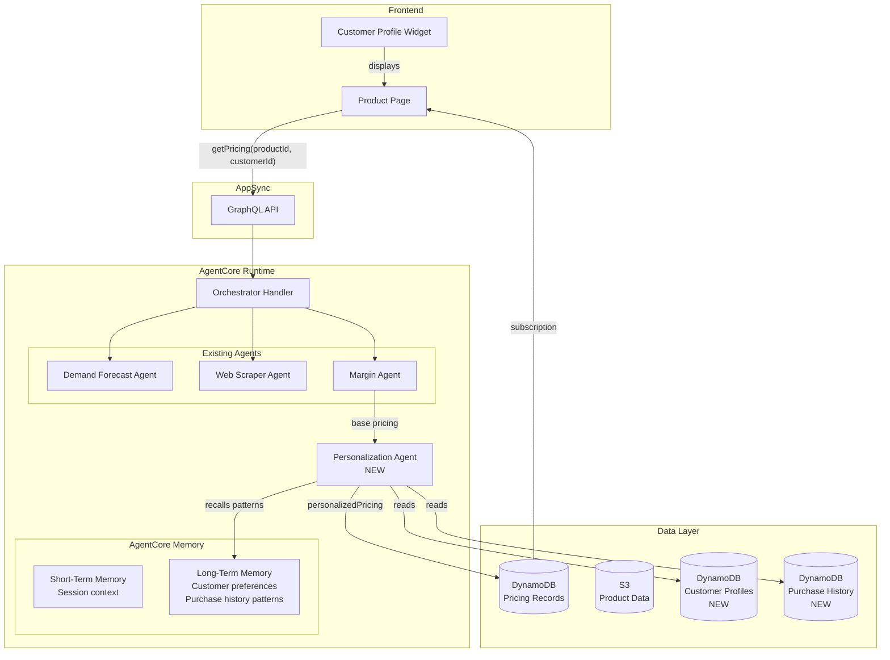
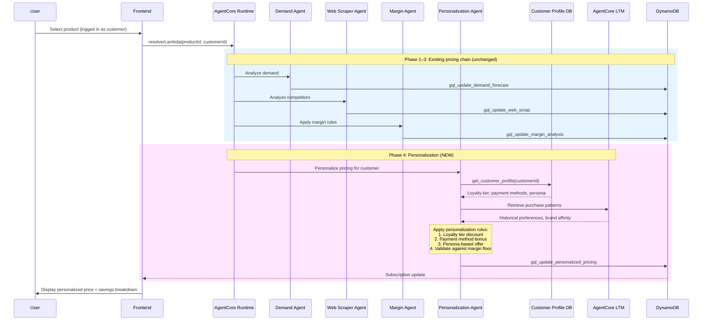
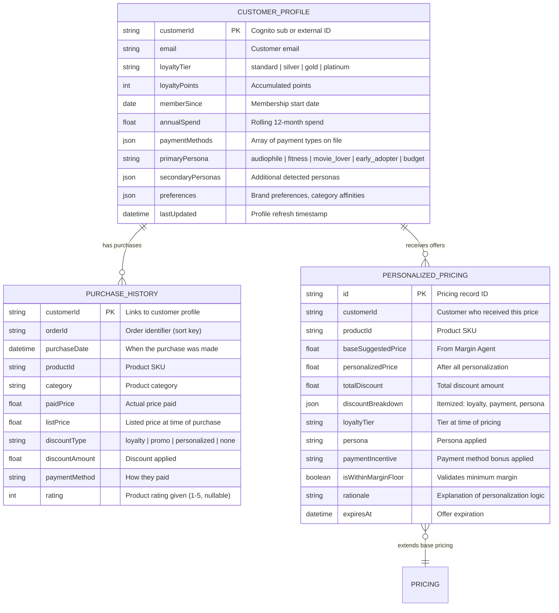

# Personalized Pricing Recommendations — Approach Document

## Overview

Extend the Retail Pricing Agent to generate personalized price recommendations based on individual customer profiles. Instead of a single price for all customers, the system produces tailored discounts considering loyalty tier, payment method, and behavioral persona — offering exclusive pricing that goes beyond standard promotions.

---

## Customer Profile Dimensions

### 1. Loyalty Tier

| Tier | Discount Range | Qualification |
|------|---------------|---------------|
| Platinum | 12–20% off suggested price | 3+ years, $5K+ annual spend |
| Gold | 8–15% off suggested price | 1–3 years, $2K+ annual spend |
| Silver | 4–10% off suggested price | 6+ months, $500+ annual spend |
| Standard | 0% (base pricing only) | All other customers |

### 2. Payment Method

| Method | Additional Discount | Rationale |
|--------|-------------------|-----------|
| Brand Credit Card | 3–5% extra | Drives card adoption, higher LTV |
| Store Gift Card | 2–3% extra | Pre-committed spend, zero payment processing cost |
| Standard Payment | 0% | Baseline |

### 3. Behavioral Persona

| Persona | Detection Signals | Pricing Strategy |
|---------|------------------|-----------------|
| Audiophile | Repeat headphone/speaker purchases, high-end SKUs, reviews audio products | Premium bundle discounts on audio accessories, loyalty pricing on flagship models |
| Fitness Enthusiast | Smartwatch + earbuds purchases, fitness app integrations | Cross-category bundles (watch + earbuds), seasonal fitness campaign pricing |
| Movie Lover | Tablet + speaker purchases, streaming accessory history | Home entertainment bundles, display upgrade incentives |
| Tech Early Adopter | Day-1 purchases, pre-orders, latest model upgrades | Early access pricing, trade-in bonuses on new releases |
| Budget Conscious | Coupon usage, sale-only purchases, price comparison behavior | Targeted flash deals, layaway/installment incentives |

---

## Architecture



## Agent Chain — Extended Flow



---

## Data Model — New Tables



---

## Personalization Agent — Design

### System Prompt (Summary)

The Personalization Agent receives the base pricing from the Margin Agent and the customer profile, then applies a layered discount strategy:

1. **Loyalty Discount** — percentage off based on tier, capped by category rules
2. **Payment Bonus** — additional percentage if customer has a brand credit card or gift card balance
3. **Persona Offer** — targeted discount or bundle based on behavioral persona (e.g., audiophile gets 5% extra on headphones, fitness enthusiast gets a watch+earbuds bundle price)
4. **Margin Floor Validation** — the final personalized price must never go below the promotional floor margin defined in margin rules
5. **Exclusivity Flag** — marks the offer as "personalized, not available via standard promotions"

### Tools

| Tool | Description |
|------|-------------|
| `get_customer_profile` | Reads customer profile from DynamoDB (loyalty tier, personas, payment methods) |
| `get_purchase_history` | Reads recent purchase history to detect patterns and validate persona |
| `retrieve_customer_memories` | Queries AgentCore LTM for long-term customer preferences and brand affinity |
| `gql_update_personalized_pricing` | Persists the personalized pricing to DynamoDB via GraphQL |

### Output Schema

```json
{
    "personalized_price": 114.99,
    "base_suggested_price": 134.99,
    "total_savings": 20.00,
    "savings_percentage": 14.8,
    "discount_breakdown": {
        "loyalty_discount": {
            "tier": "gold",
            "percentage": 10,
            "amount": 13.50
        },
        "payment_bonus": {
            "method": "brand_credit_card",
            "percentage": 3,
            "amount": 4.05
        },
        "persona_offer": {
            "persona": "audiophile",
            "type": "category_affinity",
            "percentage": 2,
            "amount": 2.70
        }
    },
    "margin_validation": {
        "final_margin": 42.1,
        "margin_floor": 35.0,
        "is_compliant": true
    },
    "offer_details": {
        "is_exclusive": true,
        "expires_at": "2026-04-16T23:59:59Z",
        "message": "Gold member exclusive: Save $20 on Sonora Pro Headphones with your brand card"
    },
    "rationale": "Gold tier loyalty (10%) + brand credit card (3%) + audiophile affinity (2%) = 14.8% personalized discount. Final price $114.99 maintains 42.1% margin above 35% floor."
}
```

---

## AgentCore Memory — Customer Intelligence

### Short-Term Memory (Session)

Stores the current pricing session context so the Personalization Agent knows what the Demand, Web Scraper, and Margin agents already determined.

### Long-Term Memory (Cross-Session)

Uses AgentCore Memory's semantic and user preference strategies to build persistent customer intelligence:

```python
memory = client.create_memory_and_wait(
    name="CustomerPricingMemory",
    strategies=[
        # Extracts customer preferences from interactions
        {"userPreferenceMemoryStrategy": {
            "name": "customer_preferences",
            "namespaces": ["/customers/{actorId}/preferences/"]
        }},
        # Extracts purchase patterns and brand affinity
        {"semanticMemoryStrategy": {
            "name": "purchase_patterns",
            "namespaces": ["/customers/{actorId}/patterns/"]
        }},
    ],
    event_expiry_days=365,
)
```

Over time, the LTM learns:
- Which brands a customer gravitates toward
- Price sensitivity (do they buy at full price or wait for sales?)
- Category preferences (audio heavy? wearables? computing?)
- Seasonal buying patterns (holiday gifter? back-to-school shopper?)

The Personalization Agent queries these memories to refine its discount strategy beyond the static rules.

---

## Frontend Changes

### Customer Profile Widget

Add a profile badge on the pricing page showing:
- Loyalty tier (with icon: 🥈 Silver, 🥇 Gold, 💎 Platinum)
- Active payment methods
- Detected persona
- "Your personalized price" callout with savings breakdown

### Personalized Pricing Panel

New panel alongside the existing Demand/Competitive/Margin panels:

```
┌─────────────────────────────────────────┐
│  💎 Your Personalized Price             │
│                                         │
│  $114.99  (was $134.99)                 │
│  ─────────────────────────              │
│  You save $20.00 (14.8%)               │
│                                         │
│  Breakdown:                             │
│  ├── Gold Member Discount    -$13.50    │
│  ├── Brand Card Bonus        -$4.05     │
│  └── Audiophile Reward       -$2.70     │
│                                         │
│  ⏰ Offer expires: Apr 16, 2026         │
│  🔒 Exclusive — not available publicly  │
└─────────────────────────────────────────┘
```

### GraphQL Schema Addition

```graphql
type PersonalizedPricing {
    personalizedPrice: Float
    baseSuggestedPrice: Float
    totalSavings: Float
    savingsPercentage: Float
    discountBreakdown: AWSJSON
    marginValidation: AWSJSON
    offerDetails: AWSJSON
    rationale: String
}

# Extend the existing Pricing type
type Pricing {
    # ... existing fields ...
    personalizedPricing: AWSJSON
}
```

---

## Implementation Plan

### Phase 1: Customer Profile Infrastructure (Week 1)

- Create `CustomerProfile` DynamoDB table with GSI on `loyaltyTier`
- Create `PurchaseHistory` DynamoDB table with GSI on `customerId`
- Seed synthetic customer profiles (10 customers across all tiers and personas)
- Seed purchase history data (50–100 orders) using Nova Lite
- Add `get_customer_profile` and `get_purchase_history` Strands tools

### Phase 2: Personalization Agent (Week 2)

- Write the Personalization Agent system prompt with discount rules
- Implement the `gql_update_personalized_pricing` tool
- Wire the agent as Phase 4 in the handler chain (after Margin Agent)
- Add personalization rules to S3 (`data/personalization_rules.json`):
  - Loyalty tier discount tables
  - Payment method bonus rates
  - Persona-category affinity matrix
  - Margin floor overrides for personalized pricing

### Phase 3: AgentCore Memory Integration (Week 2–3)

- Create LTM memory resource with `userPreferenceMemoryStrategy` and `semanticMemoryStrategy`
- Save purchase events to memory after each pricing decision
- Add `retrieve_customer_memories` tool that queries LTM for customer patterns
- Train the memory with historical purchase data

### Phase 4: Frontend (Week 3)

- Add customer profile selector to the Home page (dropdown or login-based)
- Create `PersonalizedPricingPanel` component
- Add `personalizedPricing` field to the GraphQL subscription
- Display savings breakdown with tier badge and expiration

### Phase 5: Validation & Guardrails (Week 3–4)

- Ensure personalized price never goes below margin promotional floor
- Add audit logging for every personalized offer (who, what, why, when)
- Implement offer expiration (7-day default, configurable per tier)
- Add A/B testing flag to compare personalized vs. standard pricing conversion rates
- Rate limiting: max 3 personalized price requests per customer per product per day

---

## Example Scenarios

### Scenario 1: Gold Member + Brand Card + Audiophile

```
Customer: Sarah Chen (Gold, 2 years, $3.2K annual spend)
Product: SONORA-HP-PRO200 (Suggested: $134.99)
Payment: Brand Credit Card

Personalization:
  Gold loyalty:     -10% = -$13.50
  Brand card:        -3% = -$4.05
  Audiophile (headphones category match): -2% = -$2.70

Personalized Price: $114.74
Margin check: 42.1% (floor: 35%) ✅
Offer: "Gold member exclusive — save $20.25 on Sonora Pro Headphones"
```

### Scenario 2: Platinum Member + Fitness Enthusiast

```
Customer: Marcus Johnson (Platinum, 4 years, $7.5K annual spend)
Product: SMART-SW-MID100 Smartwatch (Suggested: $89.99)
Payment: Standard

Personalization:
  Platinum loyalty: -15% = -$13.50
  Fitness persona (smartwatch category match): -3% = -$2.70

Personalized Price: $73.79
Margin check: 38.2% (floor: 30%) ✅
Offer: "Platinum exclusive — your fitness reward price on Smart Fit Watch"
```

### Scenario 3: Silver Member + Budget Conscious

```
Customer: Alex Rivera (Silver, 8 months, $800 annual spend)
Product: NET-WR-LITE100 Router (Suggested: $49.99)
Payment: Store Gift Card

Personalization:
  Silver loyalty:    -5% = -$2.50
  Gift card bonus:   -2% = -$1.00
  Budget persona: flash deal eligible (no extra %)

Personalized Price: $46.49
Margin check: 28.5% (floor: 25%) ✅
Offer: "Silver member deal — extra savings with your gift card balance"
```

### Scenario 4: Margin Floor Protection

```
Customer: Premium member requesting deep discount on low-margin entry product
Product: ECHO-SP-ENT110 Speaker (Suggested: $34.99, cost: $22.00)
Payment: Brand Card

Personalization attempt:
  Platinum loyalty: -15% = -$5.25
  Brand card:        -3% = -$1.05
  Persona bonus:     -2% = -$0.70

Calculated price: $27.99 → Margin: 21.4%
Margin floor: 25% → VIOLATION

Resolution: Cap discount at margin floor
  Adjusted price: $29.33 (25% margin)
  Actual discount: 16.2% instead of 20%
  Flag: "Discount capped to maintain minimum margin"
```
